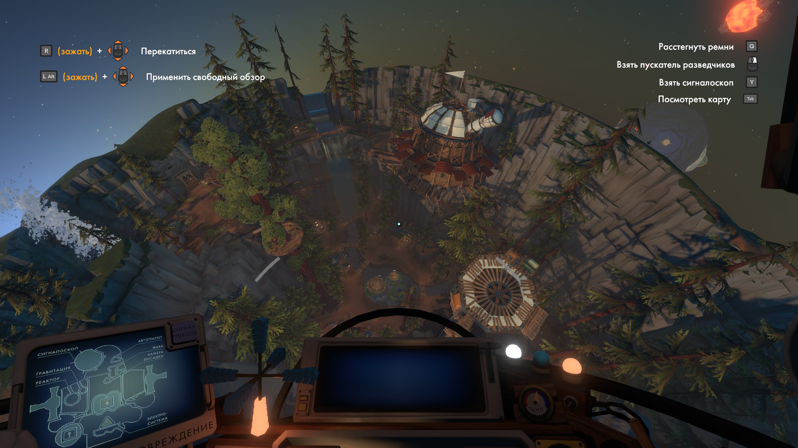
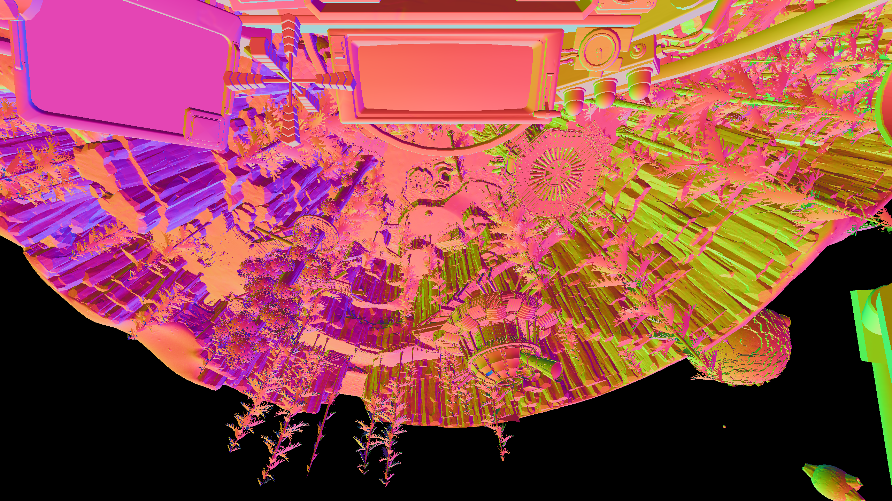
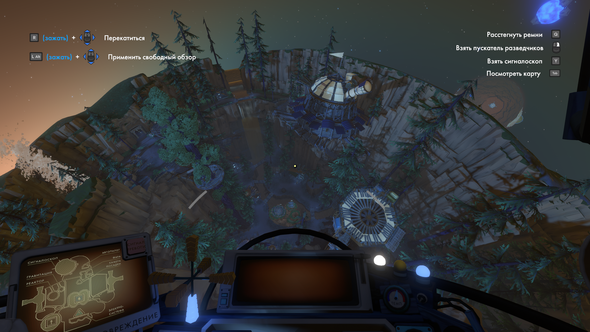

В RenderDoc захватил кадр из Outer Wilds (если вы не играли, пожалуйста, поиграйте в outer wilds. Только ничего не гуглите умоляю). Игра использует Direct3D 11.

Сначала геометрия заполняет G-buffer и глубину. Карты теней строятся отдельно, а освещение считается по уже записанным данным. Далее выполняются постобработка, интерфейс и вывод готовой картинки. Геометрия рисуется индексированными треугольниками. Есть инстансинг (в событии 3362 одним вызовом рисуются 20 копий одной сетки).

В event browser посмотрел порядок команд, в pipeline state посмотрел шейдеры и буферы. texture viewer вроде показывает промежуточные изображения, а mesh viewer вершины до и после gприменения шейдера. Ниже идет буфер нормалей - цвета обозначают направления поверхностей. При экспорте он получился перевёрнутым.

В байткоде финального пиксельного шейдера нашёл одну команду `sample_indexable` — (вероятно) чтение цвета из текстуры. Заменил шейдер на вариант с `return color.bgra;` который меняет местами красный и синий каналы. Огонь и оранжевые элементы интерфейса стали синими (ну в целом как и ожидалось).

